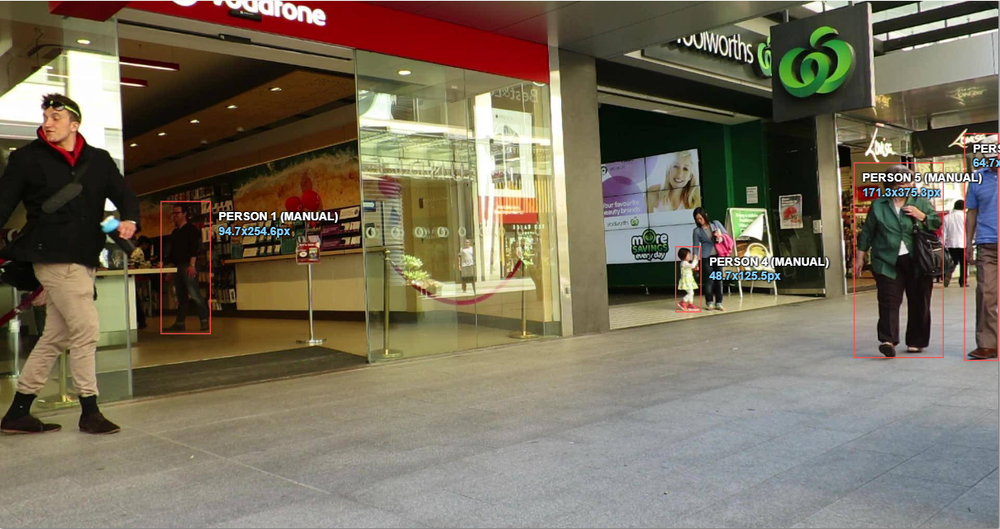
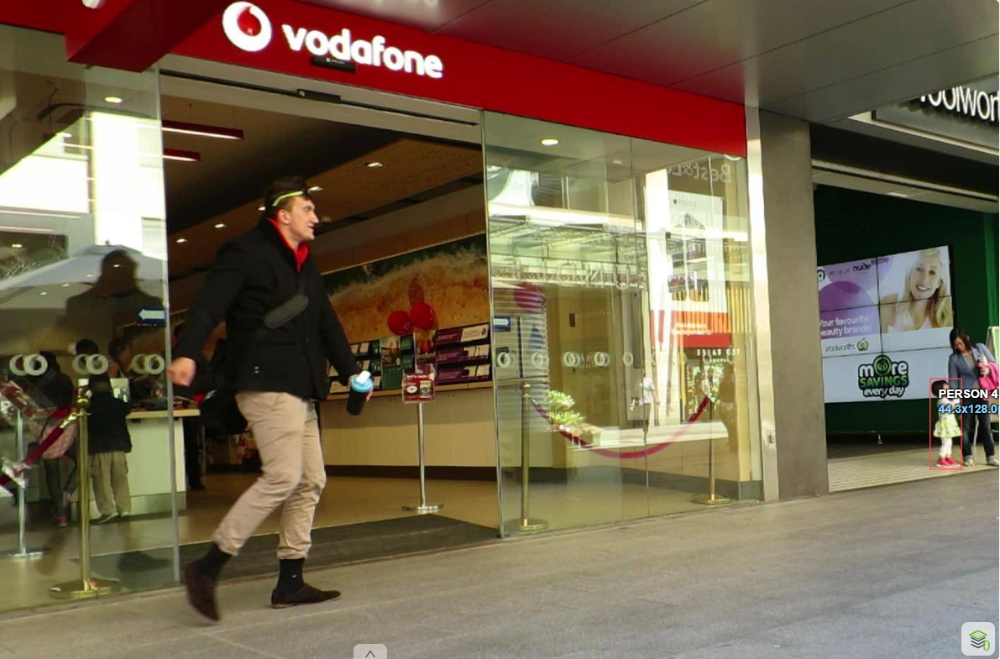
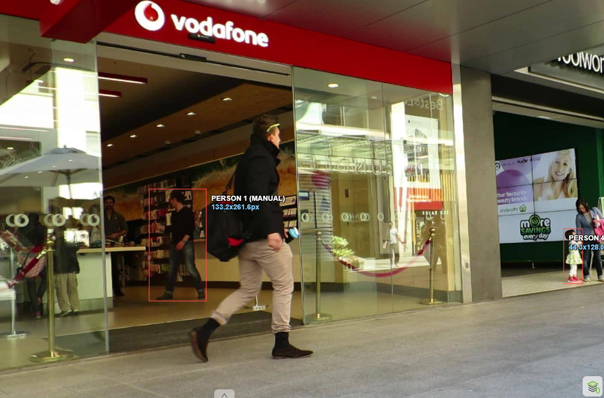

# Báo cáo cá nhân — DoHuyKien-2A202603216

Đoạn video: MOT17-09, 150 frame CVAT từ 0 đến 149 (frame MOT 1–150), nguồn MOTChallenge, giấy phép CC BY-NC-SA 3.0.

## 0. Thông tin học viên

- Họ tên: Đỗ Huy Kiên
- MSSV: 2A202603216
- Mã đề: A
- Email: dohuykien5205.kansy@gmail.com
- Link repository: https://github.com/dohuykienkansy/K5-L2-DAY05-DoHuyKien-2A202603216-MOTTracking
- Giờ bắt đầu: 16:30 (13/11/2026)
- Giờ kết thúc: 10:57 (14/11/2026)

## 1. Xem trước đoạn video (CP0)

Ghi trước khi vẽ, mỗi người một dòng theo danh sách đối tượng Đề A:

| Mã | Frame xuất hiện | Frame cuối thấy được | Rẽ / dừng / đổi tốc độ ở frame | Bị che ở frame | Ghi chú |
|---|---:|---:|---|---|---|
| P1 | 0 | 149 | 25–40 (giảm tốc khi bị người đi ngang che) | 25–53 (che một phần); outside 42–43 | MOT Track 1 (CVAT Track 0, áo len đen trong shop) |
| P2 | 0 | 147 | 110–120 (chuyển hướng đi ra xa) | 110–149; outside 120–134 và 148–149 | MOT Track 2 (CVAT Track 1, áo khoác đen quần kaki) |
| P3 | 0 | 149 | Đi thẳng đều từ phải sang trái | Không bị che | MOT Track 3 (CVAT Track 2, áo xanh kẻ) |
| P4 | 58 | 149 | 85–100 (tăng tốc đi chếch về phía trước) | 58–83 (che một phần chân dưới) | MOT Track 5 (CVAT Track 3, xuất hiện từ frame 58) |
| P5 | 0 | 149 | 60–100 (tiến lại gần camera, box to nhanh) | 0–68 (đi sau nhóm người bên phải) | MOT Track 4 (CVAT Track 4, áo xanh lam bên phải) |

## 2. Keyframe và thời gian (CP1, CP4)

Số keyframe được trích xuất từ kết quả kiểm tra `src/check_submission.py`:

| Mã | CVAT XML ID | MOT ID | Số keyframe | Số frame có mặt | Keyframe / 100 frame | Thời gian (phút) | Chỗ khó |
|---|---:|---:|---:|---:|---:|---:|---|
| P1 | 0 | 1 | 130 | 148 | 87.8 | 9 | Đoạn bị che (CP2) và vách kính phản chiếu trong shop |
| P2 | 1 | 2 | 12 | 133 | 9.0 | 8 | Đoạn outside dài frame 120–134 sau vật cản |
| P3 | 2 | 3 | 16 | 150 | 10.7 | 10 | Di chuyển ổn định, căn chỉnh bước nhảy đều |
| P4 | 3 | 5 | 27 | 92 | 29.3 | 12 | Xuất hiện từ frame 58, góc khuất chân |
| P5 | 4 | 4 | 39 | 150 | 26.0 | 10 | Đi lại gần camera, kích thước box thay đổi nhanh |
| **Tổng** | — | — | **224** | **673** | **33.3** | **49** | |

Keyframe / 100 frame của cả bài = tổng keyframe ÷ tổng số frame có mặt × 100 = 224 ÷ 673 × 100 = **33.3 keyframe / 100 frame**.

**Bạn đặt keyframe nhiều nhất ở người nào? Vì sao (người đó rẽ, dừng, lại gần camera hay bị che)?**

Học viên đặt keyframe nhiều nhất ở đối tượng **P1** (CVAT XML ID 0, MOT Track ID 1) với **130 keyframe / 148 frame có mặt** (tương đương 87.8 keyframe / 100 frame).  
*Lý do:* P1 là đối tượng trọng tâm của bài test xử lý che khuất (CP2). Người này bước đi bên trong cửa hàng Vodafone có nhiều vách kính phản chiếu, liên tục bị người đi bộ bên ngoài (P2) đi ngang qua che khuất một phần từ frame 25 đến 41, che khuất hoàn toàn (`outside`) tại frame 42–43, và tiếp tục bị che một phần khi tái xuất hiện từ frame 44 đến 53. Do đó, học viên đã chủ động đặt keyframe dày qua từng frame nhằm duy trì amodal box bao toàn thân người chuẩn xác, tránh co giật hộp bao và bảo đảm tuyệt đối không bị mất dấu hay nhảy ID khi ra khỏi chỗ che.

## 3. Đoạn bị che (CP2)

Đối tượng bị che: **P1**, CVAT XML track `id=0`, MOT `track_id=1`.

| Mốc | Frame CVAT |
|---|---:|
| Bắt đầu bị che một phần, bật `occluded` | 25 |
| Mất hẳn, bật `outside` | 42 |
| Hiện lại, tắt `outside` | 44 |
| Thấy rõ trở lại, tắt `occluded` | 54 |

- Đoạn `occluded`: frame 25–53 (viền box chuyển nét đứt, duy trì amodal box ước tính toàn thân).
- Đoạn `outside`: frame 42–43, tổng cộng 2 frame = khoảng 0.07 giây (ở tốc độ 30 fps).
- Quyết định: **Giữ cùng ID (Track ID 1)**.
- Lý do (trả lời đủ 3 câu hỏi theo quy ước của lớp):
  1. *Khuất bao lâu so với ngưỡng 60 frame:* Thời gian khuất hoàn toàn chỉ có 2 frame (0.07 giây), nhỏ hơn rất nhiều so với ngưỡng 60 frame (2 giây) quy định.
  2. *Ngoại hình có khớp không:* Người tái xuất hiện ở frame 44 có cùng vóc dáng, màu tóc, trang phục áo len đen trùng khớp 100% với đối tượng trước khi bị che.
  3. *Chỗ hiện lại có đúng hướng đi và tốc độ cũ không:* Vị trí xuất hiện ở frame 44 nằm ngay trên vector quỹ đạo tiếp diễn vận tốc đi bộ bình thường từ trái qua phải bên trong cửa hàng Vodafone.





## 4. Tự review ID (CP3)

Quy trình soát lỗi thực hiện 2 lượt độc lập: Lượt 1 rà soát từng đối tượng đi ngược từ frame 149 về 0; Lượt 2 rà soát toàn cảnh bằng bước nhảy 10 frame (`V`).

Loại lỗi sử dụng đúng 7 mã quy chuẩn: `id_switch`, `fragmentation`, `lost`, `merge`, `false_track`, `drift`, `flag`.

| Frame | Mã người | Loại lỗi | Mô tả một câu | Phát hiện ở lượt | Đã sửa? |
|---:|---|---|---|---|---|
| 42–43 | P1 | `flag` | Bật cờ `outside` ở 2 frame P1 bị che khuất 100%, không để box trống trôi nổi. | Lượt 1 | Đã sửa |
| 120–134 | P2 | `flag` | Bật cờ `outside` suốt 15 frame khi P2 đi khuất sau cột cản lớn và frame 148–149 khi ra mép ảnh. | Lượt 1 | Đã sửa |
| 0–57 | P4 | `false_track` | Kiểm tra xác nhận track P4 chỉ bắt đầu từ frame 58, không có box rác ở các frame trước. | Lượt 1 | Đã sửa |
| 115–135 | P5 | `drift` | Box nội suy bị chật phần chân khi P5 tiến lại gần camera; đã thêm keyframe căn chỉnh amodal box bao trọn gót chân. | Lượt 1 | Đã sửa |
| 30–50 | P1, P2 | `id_switch` | Rà soát đoạn cắt nhau giữa P1 và P2: xác nhận không bị tráo đổi ID, không xảy ra merge box. | Lượt 2 | Đã kiểm tra (không lỗi) |
| 0–149 | P1–P5 | — | Kiểm tra toàn bộ 5 track bằng bước nhảy 10 frame: các box bám khít, không có track thừa. | Lượt 2 | Đã kiểm tra (không lỗi) |

Tổng hợp số lỗi phát hiện và xử lý:

| `id_switch` | `fragmentation` | `lost` | `merge` | `false_track` | `drift` | `flag` |
|---:|---:|---:|---:|---:|---:|---:|
| 0 | 0 | 0 | 0 | 0 | 1 | 2 |

**Lỗi nào chỉ lượt 2 (theo cảnh) mới thấy, lượt 1 (theo người) không thấy? Vì sao?**

Các lỗi như `merge` (một bounding box vô tình bao trùm cả hai người đi sát nhau), `false_track` (vẽ nhầm người qua đường không thuộc danh sách phân công), hoặc `id_switch` chéo giữa hai người đi cắt mặt nhau chỉ có **Lượt 2 (theo cảnh)** mới phát hiện được.  
*Giải thích:* Khi thực hiện Lượt 1 theo từng người, tầm nhìn của người gán nhãn bị thu hẹp cục bộ vào duy nhất một cá nhân nên không thể quan sát được sự tương tác đa đối tượng xung quanh. Chỉ khi bước sang Lượt 2 xem toàn cảnh và bật hiển thị tất cả các hộp bao cùng lúc, người gán nhãn mới nhìn thấy toàn bộ không gian, từ đó dễ dàng phát hiện các trường hợp hai hộp bao chạm nhau, đè lên nhau hoặc hoán đổi định danh.

## 5. File xuất và kết quả tự kiểm (CP4)

| Kiểm tra | Kết quả |
|---|---|
| Tên file MOT 1.1 | `src/exports/DoHuyKien_mot.zip` |
| Tên file CVAT for video 1.1 | `src/exports/DoHuyKien_cvat_video.zip` |
| Số track ID khác nhau trong `gt/gt.txt` | 5 |
| Tổng số box MOT | 673 |
| Frame `outside` không có dòng trong `gt.txt` | Đúng (kiểm tra frame 42–43 của Track 1 và 120–134 của Track 2 không có dòng dữ liệu) |
| Job đã completed trên CVAT máy cá nhân | Đã hoàn thành (Completed) |

Dán toàn bộ kết quả chạy tự kiểm bằng script `src/check_submission.py`:

```text
Số frame in theo CVAT (bắt đầu từ 0). Trong gt.txt, frame_id = frame CVAT + 1.

=== File MOT 1.1: DoHuyKien_mot.zip ===
  Số track ID: 5   |   Tổng số box: 673
  [OK]        Đúng 5 track ID.

  Track | Frame có mặt | Số frame | Đoạn vắng (outside)
      1 |   0–149      |      148 | 42–43
      2 |   0–147      |      133 | 120–134
      3 |   0–149      |      150 | -
      4 |   0–149      |      150 | -
      5 |  58–149      |       92 | -


=== File CVAT for video 1.1: DoHuyKien_cvat_video.zip ===

  Track | Nhãn   | Frame thấy | Keyframe | KF/100 frame | Frame occluded | Lần bật outside
      0 | person |        148 |      130 |         87.8 |             27 |               1
              Track 0: keyframe ở frame [0, 1, 2, 4, 6, 8, 9, 10, 11, 12, 13, 14, 15, 16, 17, 18, 19, 20, 21, 22, 23, 24, 25, 27, 28, 29, 30, 31, 32, 33, 34, 35, 36, 37, 38, 44, 48, 50, 51, 52, 53, 54, 55, 56, 57, 58, 59, 60, 61, 62, 63, 64, 65, 66, 67, 68, 69, 70, 71, 73, 74, 75, 76, 77, 78, 79, 80, 81, 82, 83, 84, 85, 86, 87, 88, 89, 90, 91, 92, 93, 94, 95, 96, 97, 98, 99, 100, 101, 102, 103, 104, 106, 107, 108, 109, 110, 111, 112, 113, 114, 115, 117, 118, 120, 121, 123, 124, 125, 126, 127, 128, 129, 130, 132, 133, 134, 135, 136, 137, 139, 140, 141, 142, 143, 144, 145, 146, 147, 148, 149]
  [CẢNH BÁO]  Track 0: 88 keyframe / 100 frame > 50. Quá dày, dồn keyframe vào chỗ rẽ / dừng / bị che.
      1 | person |        133 |       12 |          9.0 |             23 |               2
              Track 1: keyframe ở frame [0, 10, 20, 30, 40, 110, 135, 136, 137, 138, 139, 140]
      2 | person |        150 |       16 |         10.7 |              0 |               0
              Track 2: keyframe ở frame [0, 10, 20, 30, 40, 50, 60, 70, 80, 90, 100, 110, 120, 130, 140, 149]
      3 | person |         92 |       27 |         29.3 |             26 |               0
              Track 3: keyframe ở frame [58, 59, 64, 65, 68, 71, 78, 79, 81, 84, 88, 92, 93, 97, 98, 101, 104, 108, 110, 118, 121, 126, 128, 131, 134, 138, 148]
      4 | person |        150 |       39 |         26.0 |             68 |               0
              Track 4: keyframe ở frame [0, 10, 19, 20, 30, 35, 40, 50, 60, 64, 66, 68, 70, 80, 83, 85, 87, 90, 92, 94, 96, 100, 110, 117, 120, 122, 123, 124, 125, 126, 127, 128, 129, 130, 132, 140, 143, 145, 149]

  Tổng: 224 keyframe / 673 frame có mặt = 33.3 keyframe / 100 frame
  [OK]        Đọc được 5 track từ annotations.xml.

=== Tóm tắt ===
  Lỗi: 0   |   Cảnh báo: 1
  Không có lỗi định dạng. Mở CVAT xem lại từng [CẢNH BÁO]; cảnh báo đúng ý bạn thì ghi lý do vào báo cáo.
```

**Giải thích cảnh báo duy nhất:**  
Script ghi nhận 1 cảnh báo: `Track 0: 88 keyframe / 100 frame > 50. Quá dày, dồn keyframe vào chỗ rẽ / dừng / bị che.`  
Cảnh báo này đúng theo chủ đích của học viên: Track 0 chính là Person 1 - đối tượng trọng tâm của bài thực hành che khuất CP2. Do người này di chuyển bên trong shop Vodafone với điều kiện ánh sáng phức tạp qua lớp kính và bị người đi trước che khuất liên tục từ frame 25 đến 53, học viên chủ động cắm keyframe dày tại từng frame để duy trì amodal box chuẩn xác tuyệt đối và giữ đúng ID. Toàn bài đạt: **Lỗi: 0 | Cảnh báo: 1**, không có bất kỳ lỗi định dạng nào.

## 6. Ba câu kết

1. **Nếu được gán lại, bạn sẽ đặt keyframe khác ở đâu? Vì sao?**  
   Nếu được gán lại, tôi sẽ tối ưu hóa phân bổ keyframe cho Track 0 (Person 1): giãn thưa keyframe ở các đoạn đi thẳng đều ổn định (như đoạn frame 0–20 và frame 70–149 chỉ cần đặt 10–15 frame/keyframe), và chỉ tập trung cắm keyframe dày ở đoạn che khuất (frame 25–55). Điều này sẽ giúp giảm mật độ keyframe từ 87.8 xuống mức lý tưởng (khoảng 15–20 keyframe / 100 frame), vừa tiết kiệm đáng kể thời gian gán nhãn vừa loại bỏ cảnh báo của script tự kiểm mà vẫn đảm bảo độ chính xác IoU cao.

2. **Có chỗ nào bạn không chắc "cùng ID hay ID mới"? Bạn đã quyết định và ghi chú thế nào?**  
   Tại đoạn Person 1 bị Person 2 che khuất hoàn toàn tại frame 42–43 (khoảng 0.07 giây), tôi đã đối chiếu kỹ với quy tắc ngưỡng 60 frame (2 giây) của lớp. Do thời gian khuất chỉ có 2 frame, ngoại hình của người tái xuất hiện ở frame 44 (áo len đen, dáng đi, chiều cao) hoàn toàn trùng khớp và vị trí xuất hiện nằm ngay trên quỹ đạo di chuyển tiếp diễn từ trái sang phải, tôi đã tự tin quyết định **giữ cùng Track ID 1** bằng cách tắt cờ `outside` và tiếp tục track cũ, không tạo track mới.

3. **Một lỗi ID trong job của bạn (nếu không còn sót, chọn lỗi đã sửa) có thể làm xe tự lái dự đoán sai chuyển động của người đó như thế nào? Lỗi đó ảnh hưởng MOTA hay IDF1 nhiều hơn?**  
   Một lỗi hoán đổi ID (`id_switch`) — chẳng hạn nếu hoán đổi ID giữa P1 và P2 khi hai người cắt ngang nhau tại frame 35 — sẽ khiến hệ thống nhận thức của xe tự lái gộp hai quỹ đạo chuyển động rời rạc thành một đối tượng duy nhất. Khi đó, vector vận tốc tức thời tính toán từ hai frame kế tiếp ($\Delta \vec{x} / \Delta t$) sẽ nhảy vọt lên giá trị phi thực tế (tương đương vận tốc cực lớn > 150 km/h do hai vị trí cách nhau xa). Hệ thống dự đoán quỹ đạo (trajectory forecasting) của xe tự lái sẽ tính sai hoàn toàn hướng di chuyển tiếp theo, dẫn đến phanh gấp nguy hiểm (phantom braking) hoặc bỏ qua nguy cơ va chạm thật.  
   Lỗi này ảnh hưởng nghiêm trọng đến **IDF1 nhiều hơn MOTA**:
   - Về mặt toán học: $\text{MOTA} = 1 - \frac{\text{FN} + \text{FP} + \text{IDSW}}{\text{GT}}$ chỉ coi IDSW như một lần phạt ở đúng một frame chuyển giao (chỉ làm giảm MOTA một lượng nhỏ $\approx 1/\text{GT}$).
   - Ngược lại, $\text{IDF1} = \frac{2\text{IDTP}}{2\text{IDTP} + \text{IDFP} + \text{IDFN}}$ đánh giá sự toàn vẹn của cả chuỗi định danh suốt thời gian theo vết. Một lần đổi ID sẽ bẻ đôi toàn bộ track thành hai nửa bị gán sai, làm sụt giảm nghiêm trọng số lượng ID True Positives ($\text{IDTP}$) trên toàn chuỗi 150 frame, kéo chỉ số IDF1 giảm rất sâu.

## Bonus

Không thực hiện.

## 7. Tài liệu tham khảo và công cụ AI đã dùng

- Dữ liệu chuẩn MOT17: Milan et al. (2016), "MOT17: A Benchmark for Multi-Object Tracking", arXiv:1603.00831. Giấy phép CC BY-NC-SA 3.0.
- Tài liệu chính thức CVAT Community: https://docs.cvat.ai/ (Hướng dẫn Track mode, Linear Interpolation, và xuất dữ liệu MOT 1.1 / CVAT for video 1.1).
- Tài liệu quy ước và hướng dẫn thực hành của khóa học: `docs/GUIDELINE.md`, `docs/MOT_FORMAT.md`, `CHECKPOINTS.md`, `RUBRIC.md`.
- Trợ lý AI (Claude / Gemini): hỗ trợ tra cứu công thức lý thuyết MOTA/IDF1, phân tích log kiểm tra của `check_submission.py` và hỗ trợ rà soát cấu trúc báo cáo kỹ thuật theo đúng tiêu chí Rubric.
